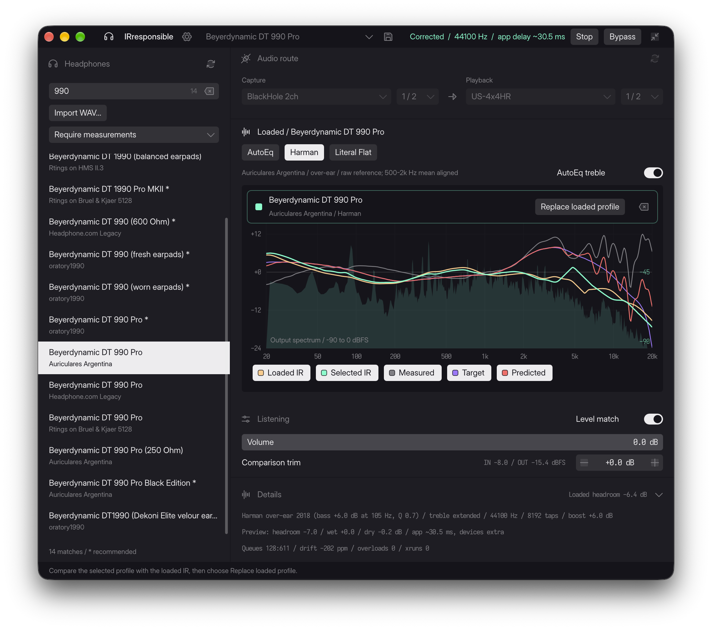

# IRresponsible

Headphone and speaker-room correction for macOS. Load AutoEq or custom WAV filters, or measure speakers with a separate mono microphone and generate independently fitted stereo FIRs. Includes reusable measurements, saved presets, and a live spectrum.

`Mac audio -> BlackHole -> IRresponsible -> headphones / audio interface`



## Install

Requires **macOS 13 or later**, audio devices at **44.1 or 48 kHz**, and **[BlackHole 2ch](https://existential.audio/blackhole/)**. Use BlackHole's official installer and restart if prompted, or run `brew install --cask blackhole-2ch`.

Quit IRresponsible before updating, then run:

```sh
curl --proto '=https' --tlsv1.2 -fsSL https://raw.githubusercontent.com/zezic/irresponsible/master/scripts/install.sh | bash
```

The installer downloads the latest release for your Mac, verifies its checksum and app signature, installs to `~/Applications`, and removes quarantine. Builds are ad-hoc signed and are not notarized yet. To choose a different folder, append `-s -- --directory /Applications` after `bash`.

You can also download the **arm64** (Apple Silicon) archive from [Releases](https://github.com/zezic/irresponsible/releases).

## First listen

1. Stop the engine if running. Select **BlackHole 2ch** as Capture and your headphones or audio interface as Playback. Allow audio capture if macOS asks.
2. Press **Start**. IRresponsible routes Mac audio through the app automatically.
3. Search for your exact headphone model. **Double-click to load**; a single click previews a comparison. Or import your own WAV impulse.
4. Use **Bypass** to compare. Save a preset with **Cmd+S**. Preferences contains IR settings, spectrum controls, themes, and **Launch at login**.

Closing the window keeps normal listening running. During room acquisition, closing it cancels probes and leaves the output muted. **Stop** or **Quit** during normal listening restores the previous output when the app owns the route. If audio goes silent after a crash, choose your headphones or interface in macOS Sound settings.

## Room correction

Open **Room** beside Headphones. In **Measure**, select the speaker output and a separate physical microphone input. Load the microphone's calibration file with the matching orientation. Keep hardware direct monitoring and voice processing disabled. Optional left/right checks help identify speakers and set recording headroom.

Choose a single listening position or the guided five-position listening area; the top view shows where each position is and the grid beside it tracks every capture. **Measure speakers** records background noise and sequential L/R sweeps, then creates one correction. Keep speaker volume and microphone gain fixed. Multi-position measurements prompt you to move the microphone; a countdown is optional.

In **Correction**, pick a target (or **Custom** to shape tilt, bass shelf and mid bell), adjust smoothing and effort on the graph or in the settings column, then press **Listen**; further edits play as soon as they are prepared. **Bypass** compares with the original. Boost and cut limiters are off by default; enable them independently for up to +24 dB boost or 36 dB attenuation. FIR length is selected automatically.

**Measure result** is optional. It checks the exact selected filter at the reference position or all measured positions and records the result without changing the filter. Acquisition still checks clipping, missing signals, clock consistency and confidence; invalid captures cannot become verified results.

Save a named measurement to retain reusable evidence, or save the correction as a preset. Reopening a measurement allows target and correction edits without a microphone. Edited filters remain available to listen to before verification. Stop, sleep or closing the window cancels probes and leaves output muted; **Resume listening** is explicit. Interrupted acquisition can resume from completed channels.

Physical loopback, microphones and speakers remain a separate acceptance step. See the [implementation and validation notes](docs/room-correction-design.md#validation).

Speaker-free development uses temporary settings and emulated endpoints:

```sh
cargo run --locked -- --simulate
cargo run --locked -- --room-simulate /tmp/room-session
cargo run --locked -- --room-simulate-realtime /tmp/room-realtime
cargo run --locked -- --simulate-smoke /tmp/room-native-smoke
cargo run --locked --features alloc-audit -- --simulate-smoke-spatial /tmp/room-spatial-smoke
cargo run --locked --release --example room-benchmark
```

`--simulate` optionally accepts a scenario JSON file. The two room simulation commands accept a scenario as their third argument, after the export directory. Scenarios support separate nominal rates, clock drift and start offsets, latency, noise, nonlinearity, callback jitter, faults, and custom stereo impulse pairs per position. These launches never select a physical playback device or change macOS system output.

## Build from source

Install [Rust](https://rust-lang.org/tools/install/) with `curl --proto '=https' --tlsv1.2 -sSf https://sh.rustup.rs | sh`, then restart your terminal. Install Apple's Command Line Tools with `xcode-select --install` if needed.

```sh
git clone https://github.com/zezic/irresponsible.git
cd irresponsible
bash scripts/package.sh
open dist/IRresponsible.app
```

The packaged app includes its icon, resources, and local signature. Rust is needed to build, not to run it.

[Technical and release reference](SPEC.md) · [AutoEq catalogue and measurements](https://github.com/jaakkopasanen/AutoEq)
