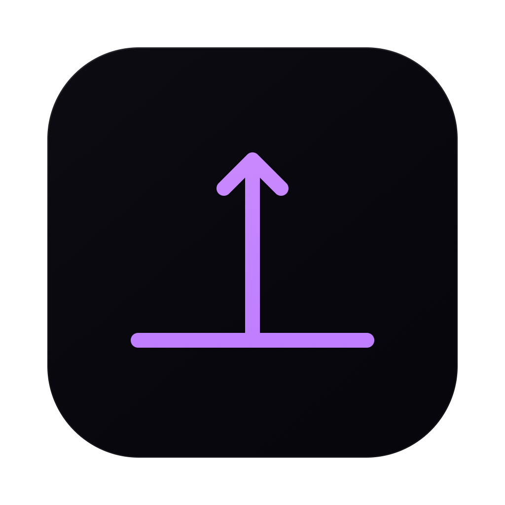
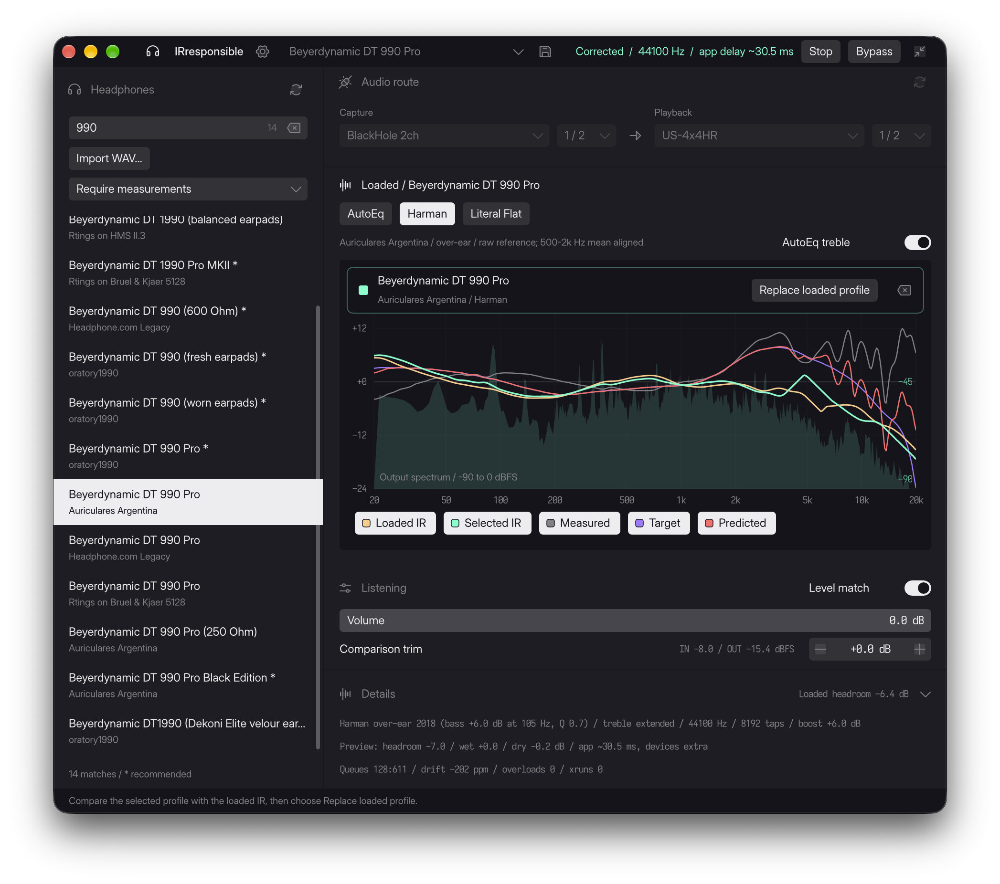

# IRresponsible

Headphone correction for macOS: find your headphones in AutoEq, load a correction, and compare it with bypass. Includes custom WAV impulses, saved presets, and a live spectrum.

`Mac audio -> BlackHole -> IRresponsible -> headphones / audio interface`



## Install the prerequisites

- **macOS 13 or later**, with audio devices at **44.1 or 48 kHz**.
- **[BlackHole 2ch](https://existential.audio/blackhole/)**: use the official installer and restart if prompted. With Homebrew: `brew install --cask blackhole-2ch`.
- **[Rust](https://rust-lang.org/tools/install/)**: install the current stable toolchain with rustup:

  ```sh
  curl --proto '=https' --tlsv1.2 -sSf https://sh.rustup.rs | sh
  . "$HOME/.cargo/env"
  ```

- **Apple Command Line Tools**: run `xcode-select --install` if they are not installed.

## Build the app

```sh
git clone https://github.com/zezic/irresponsible.git
cd irresponsible
bash scripts/package.sh
open dist/IRresponsible.app
```

Packaging creates `dist/IRresponsible.app` with its icon and resources, signed locally. Copy it to Applications if you want to keep it there. Rust is needed to build, not to run the packaged app.

## First listen

1. Stop the engine if running. Select **BlackHole 2ch** as Capture and your headphones or audio interface as Playback. Allow audio capture if macOS asks.
2. Press **Start**. IRresponsible routes Mac audio through the app automatically.
3. Search for your exact headphone model. **Double-click to load**; a single click previews a comparison. Or import your own WAV impulse.
4. Use **Bypass** to compare. Save a preset with **Cmd+S**. Preferences contains IR settings, spectrum controls, themes, and **Launch at login**.

Closing the window keeps audio running. **Stop** or **Quit** restores the previous output when the app owns the route. If audio goes silent after a crash, choose your headphones or interface in macOS Sound settings.

[Technical reference](SPEC.md) · [AutoEq catalogue and measurements](https://github.com/jaakkopasanen/AutoEq)
